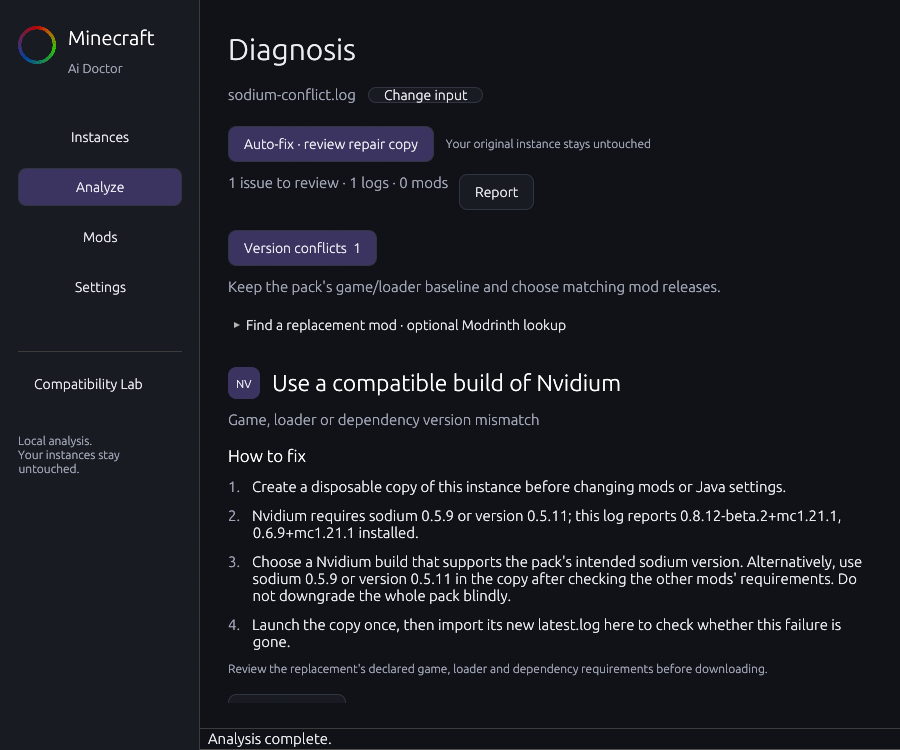

# Minecraft Ai Doctor

Formerly Prism AI Doctor. Existing saved keys and local data continue to use the legacy storage identifiers; no credential or backup migration is required.


A native Rust desktop companion for Minecraft launch problems. Import a log or inspect a mod folder, get local findings with original file and line references, then optionally ask an open-weight model to explain the evidence.

Independent project. Not affiliated with Prism Launcher, Lunar Client, Google, Groq or Fabulously Optimized. MIT licensed. No launcher code is forked or bundled.

Before publishing a fork or source snapshot, follow [the local publication checks](docs/PUBLISHING.md). API keys belong in Credential Manager or your process environment, never in the repository.

## Preview



The screenshot uses the included synthetic log, with no personal paths, logs or API keys. After building, open that example with `cargo run --release --locked -- --log tests/fixtures/sodium-conflict.log`. This is a desktop app; a recorded video and live Gemma demonstration are still pending. See [DEV_POST.md](DEV_POST.md) for the unpublished challenge write-up.

## Run on Windows

Build from source, then launch the executable:

```powershell
cargo build --release --locked
.\target\release\minecraft-ai-doctor.exe
```

Requires Windows x64 with a working OpenGL driver. Development requires stable Rust, MSVC C++ Build Tools and a Windows SDK. No Node, Python, local GPU inference runtime or API key is required. The executable is portable and unsigned; no installer or automatic updater is included. The combined GUI/CLI build uses the Windows console subsystem so CLI output and exit codes work normally.

If prerequisites are missing, install them yourself from their official sources or approve installation first:

```powershell
winget install --id Rustlang.Rustup -e
winget install --id Git.Git -e
winget install --id Microsoft.VisualStudio.2022.BuildTools -e --override "--wait --passive --add Microsoft.VisualStudio.Workload.VCTools --includeRecommended"
```

The existing `scripts/check-windows.ps1` checks tools and standard launcher paths without reading logs. If Windows blocks the unsigned script, review it and run the equivalent checks manually; changing execution policy is not required to build the application.

## Diagnose a launch

1. Open **Instances**. Use **All / Prism / Lunar / Dawn / Custom** to separate launchers, and search profile names. The list uses configured names and available local artwork, including Prism custom `iconKey` images and profile-local icons. Dawn names come from its profile manifest. Built-in artwork embedded in another launcher's executable is not extracted; missing or unsupported images use a readable initials/version tile. Expand **Portable or custom launcher root** for another root, or use **Open a folder**.
2. Select **Analyze** and choose **File or instance** or **Paste console**. Import `latest.log`, a crash report, a Minecraft instance or a `mods` folder, or paste console output with Ctrl+V and click **Analyze console output**. Drag and drop is also supported. Analysis runs in background workers. Pasted text is analyzed in memory, with original line numbers and the same size/line limits; no temporary log file is created.
3. Start with **Duplicate mods**, then **Version conflicts** or **Missing dependencies**. Each category has a count, a short next step and a filterable affected-mod list. Incomplete metadata observations are separate from confirmed errors. **How to fix** shows a checklist using the actual mod IDs, requirements and filenames. Local mod icons and arrows illustrate the proposed change; absent/unsupported artwork uses a labelled tile.
4. Expand **Evidence & context** for the original log/descriptor lines. For logs, **Open source in Notepad** opens the original file; the evidence shows the line to inspect. Each issue's expansion state is independent. Unconfirmed observations have their own category, and analysis notes remain collapsed.
5. Inspect **Mods** for IDs, versions, loader type and required/optional/conflicting dependency declarations.
6. Use the **Report** menu to copy or export a redacted Markdown/JSON report. Markdown includes the fix checklists. Exports create new files and never overwrite existing ones. Choose a destination outside launcher profiles.

Local checks recognize missing dependencies, duplicate IDs, version mismatches, Java class-version failures, Mixin failures, class-loading errors, memory errors and loader/launcher failures. A successful exit or absence of recognized signals is not a compatibility guarantee. A post-exit hook is not proof of a crash.

The app supports standard Prism roots, Lunar log imports and Fabric packs including Fabulously Optimized **through their actual local files**. It does not assume any particular pack inventory or Lunar internal API. There is no certified Fabulously Optimized compatibility database.

## Find the exact version to try

For named dependency/version failures, **Find a replacement** explains which mod you are looking for, its installed version and its dependency requirement. A mismatch in another mod's requirements does not mean Minecraft itself needs changing. For example, a Nvidium → Sodium mismatch keeps both identities separate and shows the Sodium versions actually found.

Click **Find mod on Modrinth**, confirm the correct project/author, then click **Use this project**. This loads its public icon and checks releases when the game/loader is known. Project search works without a detected Minecraft version; enter the exact version from your launcher in step 2, select the loader, then click **Find compatible releases**. Only the displayed mod query, game version and loader are sent for metadata lookup. No logs or keys are sent to Modrinth. An exact release appears only when metadata matches those filters and any supported requirement on that mod. Dependencies of a replacement still need review. Stable releases are listed first, then ordered by publication date. The recommendation can be copied.

Confirming a project also downloads its public icon from the direct Modrinth CDN, bounded to 512 KiB and 1024 × 1024 pixels and decoded to a small texture. PNG, WebP, JPEG and ICO artwork is supported. Confirmed artwork is cached for 7 days and reused locally on later imports, including log-only profiles with no exposed mod JARs. Before confirmation, a labelled tile appears if there is no local icon. A matching release label is not proof of runtime compatibility with the full pack; review dependencies and test a disposable copy. Missing project results, unsupported requirements and network errors remain explicit.

## Reviewed auto-fix and rollback

Click **Auto-fix · review repair copy** at the top of Diagnosis. Review which duplicate version to keep and the exact files to back up. Duplicate repair works offline. **Ask AI for a proposal** prepares the usual consented cloud request; the AI can select existing findings, while local code controls all supported file operations. After receiving its explanation, rebuild the reviewed plan.

For a replacement, first confirm the project/release under **Find a replacement**, then click **Review this change in auto-fix** or rebuild the plan from the top toolbar. Choose an already-downloaded JAR, or explicitly check **Download this exact JAR from Modrinth instead** and confirm **Download & apply**. Downloads are restricted to direct HTTPS Modrinth CDN URLs, bounded to 128 MiB, and verified against the published SHA-512, size, mod ID, exact descriptor version, loader and any declared Minecraft requirement. Redirects and unverified files are refused. Required dependencies are displayed but are not installed automatically.

Apply creates a new **mod-only** repair copy under `%LOCALAPPDATA%\PrismAIDoctor\repair-copies-v1`. It copies top-level JARs, keeps changed originals in `backup`, and journals operations for rollback. It does **not** create a complete runnable launcher instance, copy worlds/config/accounts, change your selected profile or launch Minecraft. To test, create a disposable instance in your launcher with the same game/loader baseline and use the reviewed repaired mods there. Unknown errors, shared multi-mod JARs and ambiguous version differences need manual review.

Use **Analyze copied mods** to check the changed inventory, or **Roll back this repair copy** to restore its original JARs. The latest repair is recoverable after restarting the app through the same toolbar. Rollback verifies backups and refuses to overwrite later edits. Copies are limited to 16 and a combined 4 GiB; old backups are never removed automatically. Inspect old copies before deleting them manually.

## Reusing analysis

The last four local reports are reused in memory when their inputs are unchanged. Changes to log contents, runtime metadata or JAR filename/size/modification time trigger reanalysis. AI results use the exact redacted payload, selected provider and model as the cache key and expire after 7 days. Public Modrinth metadata expires after 6 hours. Cached AI results avoid another API request; new requests still require consent. Use **Settings → Clear saved API results** to force fresh API results. Raw logs and API keys are never persisted in the cache. Cached explanations remain unverified AI interpretations.

Development verified one real example: Modrinth returned **Nvidium 0.3.1 for Minecraft 1.21.1 / Fabric**. That does not establish the correct choice for a different game/loader or prove that your pack launches. API request formats follow the official [project search](https://docs.modrinth.com/api/operations/searchprojects/) and [release list](https://docs.modrinth.com/api/operations/getprojectversions/) documentation.

## Optional cloud explanations

In **Settings**, choose Google / Gemma or Groq / Qwen, edit the model ID if necessary and enter your own key in the masked field. **Save securely** uses Windows Credential Manager. The app reads only its own named credential entries. Environment fallbacks are `GEMINI_API_KEY` and `GROQ_API_KEY`; `.env` files are not loaded. Model selection and custom paths currently last for the app session.

Defaults are `gemma-4-31b-it` and `qwen/qwen3.8-27b`. Their official documentation was checked during development: [Google hosted Gemma](https://ai.google.dev/gemma/docs/core/gemma_on_gemini_api), [Groq Qwen](https://console.groq.com/docs/model/qwen/qwen3.8-27b). Availability, quotas and prices depend on your account.

After offline analysis, expand **Optional AI explanation**, click **Prepare redacted payload**, expand the complete JSON preview, review it, check consent and click **Send this payload**. Every send requires fresh consent. Only the bounded evidence pack and prompt are sent; there is no full-file upload endpoint, telemetry or automatic cloud fallback. Cancel drops the in-flight request, but cannot recall data already received by the provider.

AI output must pass a strict JSON schema, use existing finding indexes and evidence IDs, and match structured mod/version claims to imported metadata. The surrounding explanation remains an **unverified AI interpretation**. Local findings always remain visible. The app cannot prove that arbitrary prose is factually correct or free of prompt injection.

## CLI

```powershell
.\dist\minecraft-ai-doctor.exe analyze --log .\tests\fixtures\missing.log --offline
.\dist\minecraft-ai-doctor.exe analyze --instance 'D:\Games\Prism\instances\My Pack' --offline --json
.\dist\minecraft-ai-doctor.exe analyze --mods 'D:\Games\Test Copy\mods' --offline
.\dist\minecraft-ai-doctor.exe discover --root 'D:\Portable Prism\instances'
.\dist\minecraft-ai-doctor.exe lab-plan --instance 'D:\Disposable\Test Pack'
.\dist\minecraft-ai-doctor.exe --help
```

CLI analysis always runs offline, including when `--offline` is omitted. JSON reports contain redacted retained log lines and metadata. CLI exit code 0 means analysis completed, including when findings describe errors; exit code 1 means import/command failure. Redirect output if you want a file; GUI exports provide safer create-new behavior.

## Limits and safety

- Logs: first 4 MiB, 30,000 lines, 4 KiB per line; explicit truncation warnings. UTF-8 decoding replaces malformed bytes. UTF-16 logs and `.log.gz` need a manual conversion outside the app.
- Instances: `latest.log`, optional Lunar `ichor-boot.log`, `launcher.log`, newest crash `.txt`, top-level `mods` and Prism `mmc-pack.json`. Historical crash reports are labelled as potentially stale. Custom launcher log names require manual import.
- JARs: 128 MiB/file, 20,000 archive entries, 512 MiB declared uncompressed data, 256 KiB per descriptor, 512 top-level JARs, at most 128 declared mods/JAR and 256 dependencies/mod, bounded directory enumeration. Unsafe archive paths, symlinks and Windows reparse points are rejected. Nothing is extracted or executed.
- Supported descriptors: `fabric.mod.json`, `quilt.mod.json`, `META-INF/mods.toml`, `META-INF/neoforge.mods.toml`. Nested JARs, provided aliases, Maven placeholder versions, complex Quilt groups and unfamiliar predicates remain unknown. Only the first recognized descriptor in a JAR is used.
- Version matching handles exact versions, common comparison conjunctions, alternatives, semver wildcards and simple Maven intervals. It is a conservative subset, not a replacement for the actual mod loader.
- Online version lookup is opt-in and metadata-only. Separately consented repair-copy downloads and local JAR replacement are supported; original profiles remain read-only. No account access, game launch, world access or `.mrpack` import.
- **Compatibility Lab** produces a read-only SHA-256 inventory and manual experiment plan. Automated disposable-instance creation and live experiment execution are not implemented.
- Redaction is best effort. Review every payload/export before sharing; arbitrary log text can contain private information the patterns cannot identify.

## Develop and verify

```powershell
cargo fmt --all -- --check
cargo clippy --all-targets -- -D warnings
cargo test --locked
cargo build --release --locked
.\target\release\minecraft-ai-doctor.exe --smoke-gui --log .\tests\fixtures\missing.log
```

The GUI smoke mode preloads a selected input (or waits for startup discovery), renders three frames and closes. Import failures return an error. It confirms window initialization and rendering, not every user interaction. Normal imports continue to run in background workers. Tests use synthetic logs and generated ZIPs; mocked cloud response tests make no provider calls. See [validation](docs/VALIDATION.md) for the actual recorded checks and remaining gaps.

Sources are split into `discovery`, `logs`, `mods`, `rules`, `remedies`, `versions`, `providers`, `privacy`, `ui`, `cli` and `lab`. UI work and network work use background threads; provider HTTP is asynchronous with cancellation, HTTPS-only endpoints, redirects disabled, timeouts, response limits and bounded 429/5xx retries.

The supplied `assets/logo.svg` is bundled in the interface, native window icon and Windows executable resource. The original SVG is preserved unchanged. Its Figma-specific angular gradient is converted to portable SVG paths using the supplied color stops, then rendered with `resvg`. Windows icon resources are generated by `build.rs` in Cargo's build directory using `embed-resource` and the installed SDK compiler. The older PNG remains a documentation/test fallback. No Node/Python runtime is added to the app.

Read [Privacy](PRIVACY.md), [Prism setup](docs/PRISM_SETUP.md), [Lunar logs](docs/LUNAR_LOGS.md), [Dawn logs](docs/DAWN_LOGS.md), [experiments](docs/EXPERIMENTS.md), [demo](DEMO.md) and [submission notes](SUBMISSION_NOTES.md).
